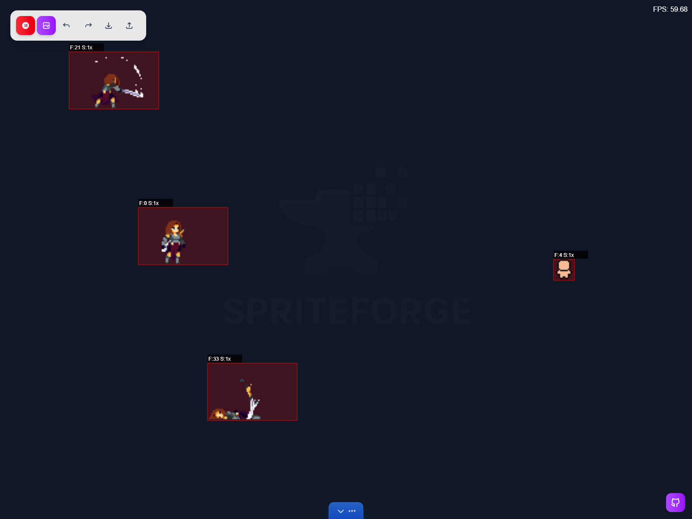
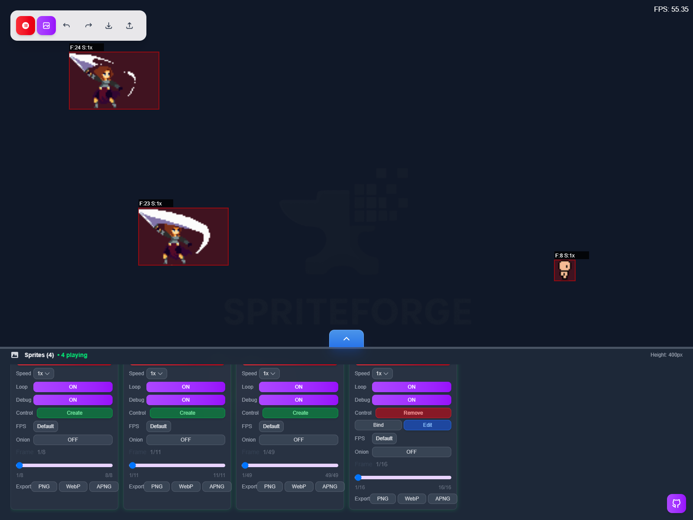
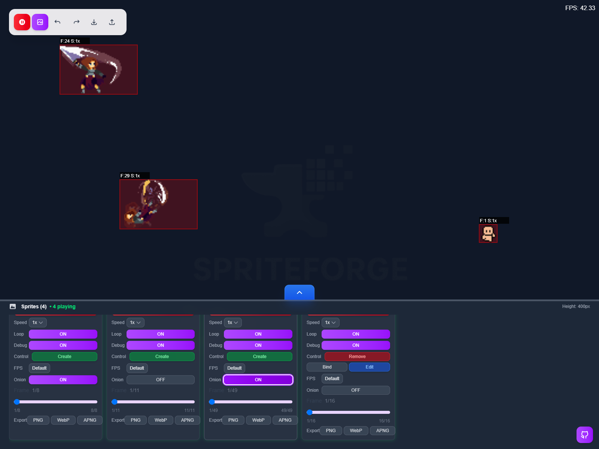
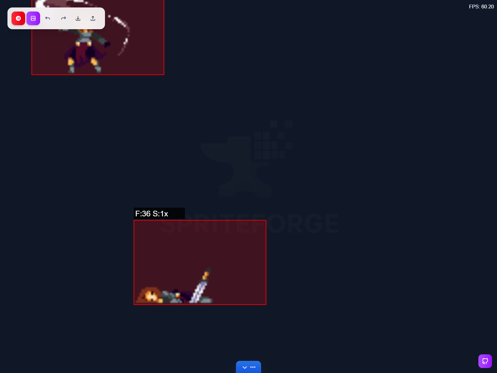
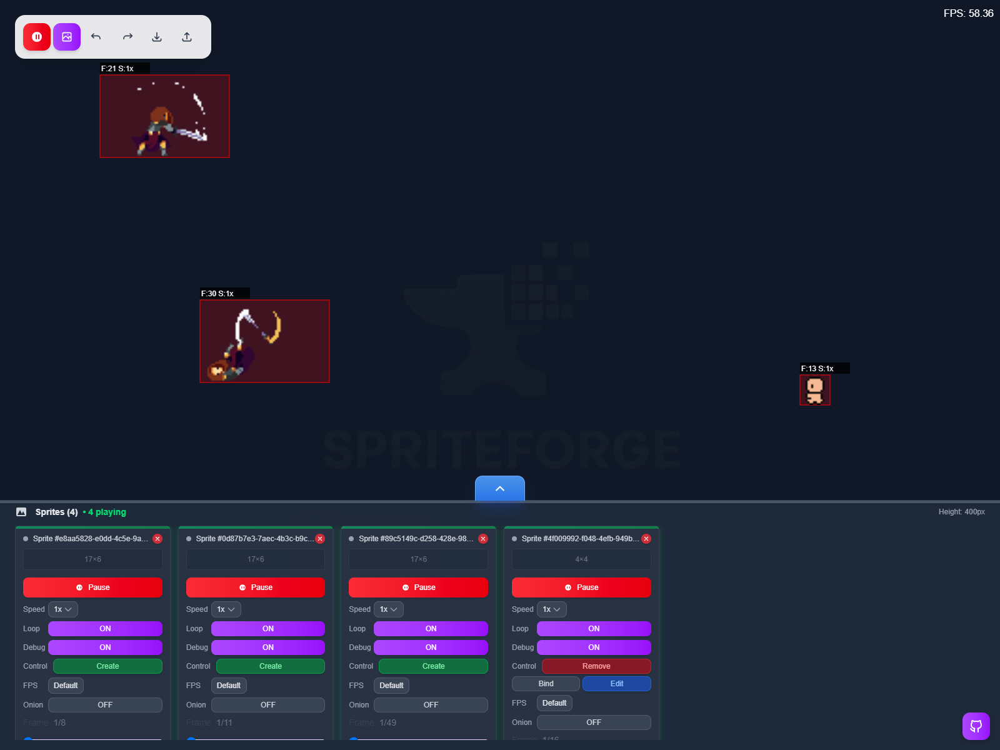

# SpriteTools - Plataforma Avanzada de Pruebas de Sprites

**SpriteTools** es una plataforma web poderosa diseñada para desarrolladores de juegos, animadores y artistas digitales para probar, previsualizar y ajustar animaciones de sprites en tiempo real. Construida con Next.js, TypeScript y HTML5 Canvas, proporciona un espacio de trabajo intuitivo para el análisis de hojas de sprites y pruebas de animación.

<p align="center">
  
</p>

## Capturas

Un recorrido por el espacio de trabajo de SpriteForge con una hoja de sprites real cargada.

<table>
<tr>
<td width="50%" valign="top">

### Animación en vivo


Varios sprites animándose a la vez en el lienzo infinito. El modo debug muestra el recuadro, el frame actual y la velocidad de cada uno, con el FPS en tiempo real.

</td>
<td width="50%" valign="top">

### Línea de tiempo y scrubber



Cada sprite tiene su deslizador de frame: pausa la animación y recorre la secuencia cuadro a cuadro para revisar un fotograma concreto.

</td>
</tr>
</table>

<table>
<tr>
<td width="50%" valign="top">

### Onion-skin



El onion-skin superpone los cuadros vecinos como fantasmas, ideal para afinar el movimiento entre frames sin perder la referencia.

</td>
<td width="50%" valign="top">

### Zoom y panorámica



La cámara hace zoom hacia el cursor con la rueda y se desplaza con el botón central, para inspeccionar hojas de sprites grandes sin perder detalle.

</td>
</tr>
</table>

<table>
<tr>
<td width="50%" valign="top">

### Panel de control



El panel inferior reúne una tarjeta por sprite: reproducir o pausar, velocidad, bucle, debug, controlador, FPS, onion-skin, el deslizador de frame y la exportación a PNG, WebP y APNG.

</td>
<td width="50%" valign="top">

&nbsp;

</td>
</tr>
</table>

## Características

### **Espacio de Trabajo de Canvas Interactivo**
- **Canvas Infinito**: Arrastra, mueve y posiciona sprites libremente por el espacio de trabajo
- **Renderizado en Tiempo Real**: Ve tus sprites animarse mientras realizas cambios
- **Soporte Multi-sprite**: Prueba múltiples sprites simultáneamente

### **Barra de Herramientas de Acciones Rápidas**
- **Crear Sprite**: Define fuente de imagen, grilla de sprite (filas/columnas), agrega patrones de animacion.
- **Secuencias de Frames Personalizadas**: Define patrones de animación complejos
- **Control del Render**: Pausa y reanuda el renderizado de los sprites.

### **Panel de Control Avanzado**
- **Gestión de Sprites**: Ve todos los sprites activos en un panel organizado y colapsable
- **Controles de Animación**: Reproduce, pausa y controla animaciones de sprites individuales
- **Control de Velocidad**: Ajusta la velocidad de animación de 0x a 5x con precision.
- **Configuración de Bucle**: Alterna entre modos de reproducción única y bucle continuo
- **Modo Debug**: Depuración visual con información de frames, límites y datos de rendimiento

### **Pruebas en Tiempo Real**
- **Vista Previa en Vivo**: Ve cambios instantáneamente mientras ajustas parámetros
- **Análisis de Frames**: Monitorea frame actual, velocidad y estado de bucle
- **Seguimiento de Posición**: Visualización de coordenadas en tiempo real
- **Monitoreo de Rendimiento**: El modo debug muestra información detallada del sprite

## Arquitectura

### Componentes Principales
- **Motor de Renderizado**: Sistema de renderizado personalizado basado en Canvas
- **Sistema de Formas**: Clases de formas modulares (Sprite)
- **Gestor de Animación**: Animación basada en frames con control de tiempo
- **Componentes UI**: Arquitectura de componentes React escalable

### Tecnologías Clave
- **Frontend**: Next.js 15 (App Router), React 19, TypeScript 5
- **Estilos**: Tailwind CSS v4 con animaciones personalizadas
- **Canvas**: API HTML5 Canvas para renderizado de alto rendimiento
- **Gestión de Estado**: Store de Zustand conectado al motor del canvas, además de React hooks y context

## Características Próximas
- **Opciones de Exportación**: Exporta animaciones como GIF, MP4 o hojas de sprites
- **Colaboración**: Comparte espacios de trabajo y colabora en tiempo real
- **Gestión de Proyectos**: Guarda, carga y organiza proyectos de sprites
- **Zoom y Panorámica**: Navega hojas de sprites grandes con facilidad

## Contribuyendo

¡Damos la bienvenida a contribuciones! Por favor, siéntete libre de enviar issues, solicitudes de características o pull requests.

### Configuración de Desarrollo
1. Haz fork del repositorio
2. Crea una rama de característica: `git checkout -b feature/caracteristica-increible`
3. Confirma tus cambios: `git commit -m 'Añadir característica increíble'`
4. Empuja a la rama: `git push origin feature/caracteristica-increible`
5. Abre un Pull Request

## Documentación técnica (cliente)

SpriteForge es una app **Next.js 15 solo-cliente**: todo el estado vive en el
`localStorage` del navegador. No hay base de datos ni backend propio.

### Stack

- **Next.js 15** (App Router) con **React 19** y **TypeScript 5**.
- **Tailwind CSS v4** para los estilos.
- **Zustand** como store, conectado al motor de render sobre **HTML5 Canvas**.
- Salida de producción en modo `standalone` de Next (`next.config.ts` →
  `output: 'standalone'`, conservando los `securityHeaders`), que emite
  `.next/standalone/server.js`.

### Scripts (`package.json`)

| Script | Comando | Descripción |
|---|---|---|
| `npm run dev` | `next dev --turbopack` | Servidor de desarrollo en `http://localhost:3000`. |
| `npm run build` | `next build` | Build de producción (salida standalone). |
| `npm run start` | `next start` | Sirve el build de producción. |
| `npm run lint` | `next lint` | Linter de Next/ESLint. |
| `npm test` | `vitest run` | Ejecuta la suite de tests una vez. |
| `npm run test:watch` | `vitest` | Tests en modo watch. |

### Andamiaje latente (desactivado por defecto)

SpriteForge incluye un andamiaje **opcional y dormido** de colaboración en
tiempo real (WebSocket) e inicio de sesión con Google (NextAuth). Mientras no se
definan sus variables (`NEXT_PUBLIC_WS_URL`, `GOOGLE_CLIENT_ID`,
`GOOGLE_CLIENT_SECRET`, `AUTH_SECRET`), el socket nunca intenta conectar y la
ruta de auth solo se valida si se invoca: la app arranca y funciona igual. Ver
[`.env.example`](./.env.example) para activarlo (no recomendado para el uso
normal).

### Ejecutar con Docker y desplegar

Un solo comando levanta la app en `http://localhost:3000`:

```bash
docker compose up --build
```

La guía completa de despliegue (local y producción) está en
[`DEPLOY.md`](./DEPLOY.md).

## Licencia

Este proyecto está licenciado bajo la Licencia MIT - ve el archivo [LICENSE](LICENSE) para detalles.

---

**SpriteTools** - Haciendo las pruebas de animación de sprites fáciles y profesionales.
